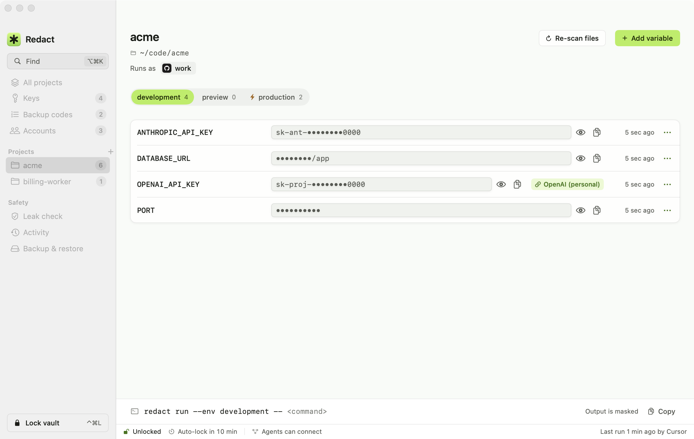
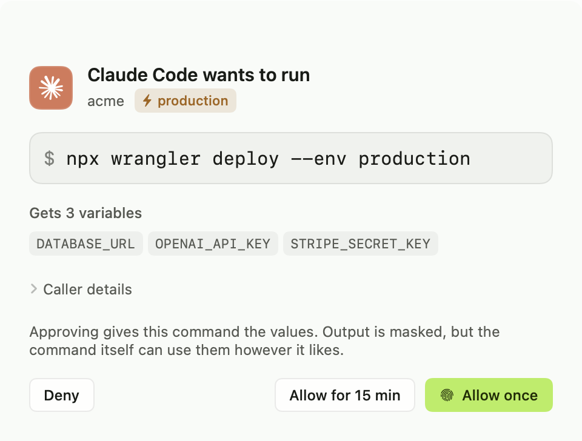
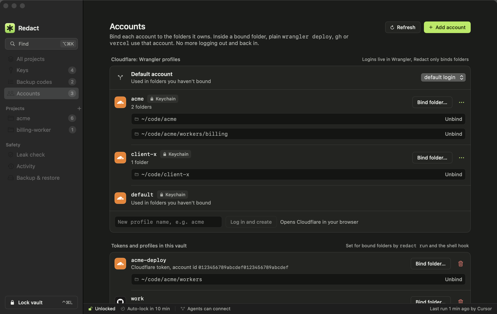
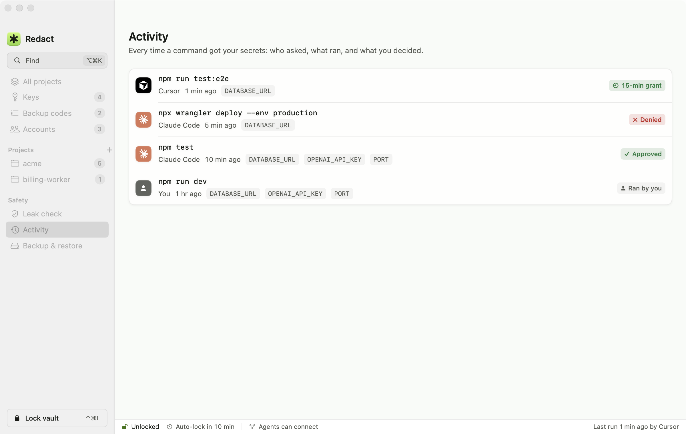
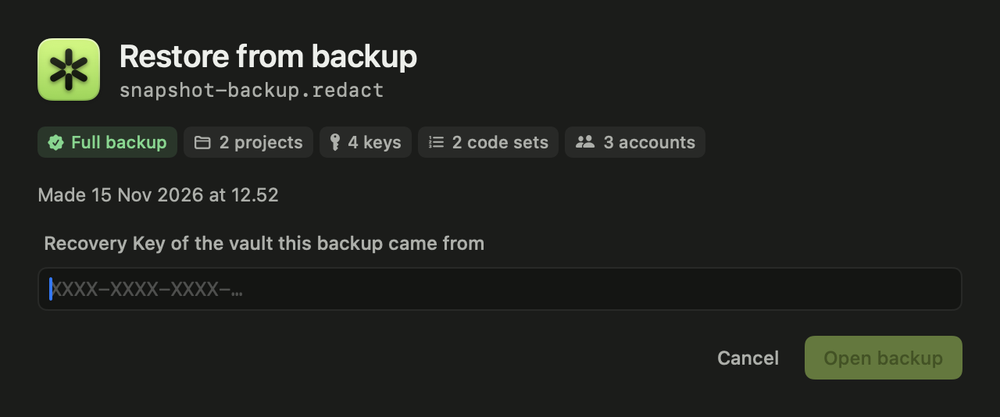

<p align="center">
  <picture>
    <source media="(prefers-color-scheme: dark)" srcset="docs/screenshots/dark/03-projects-detail.png">
    <source media="(prefers-color-scheme: light)" srcset="docs/screenshots/light/03-projects-detail.png">
    
  </picture>
</p>

<div align="center">

# Redact: secrets for your projects, without .env files

<code>rr npm run dev</code>

[Guide](GUIDE.md) · [Install](#install) · [What it does](#what-it-does) · [Security](#security) · [FAQ](#faq)

[](#install)
[](#install)
[](Package.swift)
[](LICENSE)

</div>

---

**Redact** is a Mac app that keeps your API keys and project variables in one encrypted vault instead of `.env` files. Your projects get their variables when a command runs (`rr npm run dev`), AI coding agents can run commands that use keys without ever seeing them, and each folder knows which Cloudflare, GitHub, Vercel, Supabase or AWS account it belongs to. Everything stays on your Mac: the vault key lives in the Secure Enclave and Touch ID opens it. No account, no server, no sync.

## What it does

| | What it does |
|:--|:--|
| **Vault** | One encrypted file on your Mac. The Secure Enclave holds its key, Touch ID opens it, a Recovery Key gets you back in. |
| **Projects** | Import a folder's `.env` / `.dev.vars` files once. Variables per environment (development, preview, production), shared keys linked across projects. |
| **`rr` / `redact run`** | Runs any command with the folder's variables. Nothing is written to disk. Works with monorepos (`rr -p driver …`) and `wrangler dev`. |
| **AI agents** | Claude Code, Cursor, Codex and others get an approval panel with Touch ID. Output is masked as `[redact:NAME]`. OpenAI and Anthropic keys go through a local proxy, so agents can call the API but never read the key. |
| **Accounts** | Bind a folder to a Cloudflare (Wrangler profile or token), GitHub, Vercel, Supabase or AWS account. Inside it, plain `wrangler deploy`, `gh` or `vercel` use that account. No more logging out and back in. |
| **Leak check** | Finds vault values and known key formats in your projects, git history, shell history and agent transcripts. A pre-commit hook blocks commits that contain secrets. |
| **Push** | Sends a project's variables to Cloudflare, GitHub Actions, Vercel, Supabase or AWS through each host's own CLI. |
| **Backup** | One encrypted `.redact` file, all or part of the vault, opened with your Recovery Key. Restore on a new Mac or merge into an existing vault. |

## Screenshots

| **An agent asks for production secrets** | **Accounts bound to folders** |
|:--|:--|
| <a href="docs/screenshots/light/06-approval-panel-w1.png"></a> | <a href="docs/screenshots/dark/02-identities.png"></a> |
| You see the command, the project, the environment and every variable name before anything is handed over. | Each folder deploys with its own account. |
| **Activity** | **Backup and restore** |
| <a href="docs/screenshots/light/02-activity.png"></a> | <a href="docs/screenshots/dark/08-restore-sheet-w1.png"></a> |
| Who ran what, with which variable names. Never the values. | Moving to a new Mac is one file and your Recovery Key. |

Every image opens full size if you click it. All of them use demo data.

## Install

### The .dmg (recommended)

1. Download `Redact-<version>.dmg`, open it, and drag Redact into Applications.
2. Open Redact. It isn't notarized by Apple, so macOS stops it the first time:
   - macOS 15 or later: click Done, then System Settings > Privacy & Security > **Open Anyway**.
   - macOS 14: right-click Redact in Applications > **Open**.
3. Create your vault and save the Recovery Key somewhere safe, such as your password manager.
4. **Redact > Set Up Terminal…** installs the `redact` command and the shell hook. Open a new terminal tab.

Check the download against the published checksum: `shasum -a 256 Redact-<version>.dmg`.

### From source

Requires macOS 14+ and Xcode 16 / Swift 6.

```bash
scripts/build-app.sh && scripts/install.sh
```

This copies Redact to `~/Applications` and links `redact` into `~/.local/bin`. No sudo. Details in the [Guide](GUIDE.md#build).

## Quick start

```bash
cd ~/code/my-app
redact import              # reads .env / .dev.vars into the vault, shows what's new
rr npm run dev             # runs with the variables from Redact
rr --env production npx wrangler deploy
```

Once that works, delete the `.env` files. Every command is in the [Guide](GUIDE.md).

## Security

What Redact protects against:

- **Plaintext on disk.** Values live in one encrypted vault, not in `.env` files, shell history or your repo.
- **Agents reading keys.** Only the `redact` command shipped inside Redact.app ever receives values, checked by its code signature. A script on the socket is refused. Agents need your approval and Touch ID, and their output is masked, including base64, hex and URL-encoded forms.
- **Commits with secrets.** The pre-commit hook blocks them, even while the vault is locked.
- **A lost Mac.** The vault opens only with this Mac's Secure Enclave and Touch ID, or your Recovery Key.

What it doesn't protect against:

- **A command you approve.** It gets the values and can do what it likes with them. Approve the command, not the agent.
- **Malware running as you with full control.** For example, something that opens a Terminal window and types `rr` into it.
- **Unverified downloads.** Redact isn't notarized by Apple. Check the checksum.

An independent review of the broker, masking and vault preceded this release; its fixes are in the history. Report security issues privately to support@novasilabs.xyz.

## FAQ

**Does Redact send my secrets anywhere?**
No. There is no account and no server. The only network traffic is what you ask for: the local LLM proxy forwarding to `api.openai.com` / `api.anthropic.com`, token checks against the provider you add, and `redact push` through each host's CLI.

**What happens if I lose my Mac?**
Restore a `.redact` backup with your Recovery Key on the new Mac. Without a backup and the Recovery Key, the vault can't be opened. That is the point.

**I forgot my Recovery Key.**
While Touch ID still works: Backup & restore > Replace Recovery Key. Then make a new backup, because older backups open only with the old key.

**Do I need to change my code?**
No. Your code keeps reading `process.env` (or its language's equivalent). Next.js, Vite, Expo and `wrangler dev` pick the values up from `rr`.

**Which agents does it recognise?**
Claude Code, the Claude desktop app, Cursor, Codex, Windsurf, Gemini CLI and Zed. Anything that isn't plainly you typing in a terminal app is asked, agent or not.

**Why isn't it notarized?**
That needs a paid Apple Developer account. The app is signed ad-hoc with the hardened runtime, and the source is here to build yourself.

## Roadmap

- Notarized builds and automatic updates.
- Backup reminders.
- Sharing a project with a teammate, end to end encrypted.
- The CLI checking it talks to the real Redact app before sending anything.

## Disclaimer

Redact is provided as is. It reduces the ways secrets leak; it can't make an approved command or a compromised Mac safe. Keep a backup and your Recovery Key.

## License

[MIT](LICENSE) © Novasi Labs
